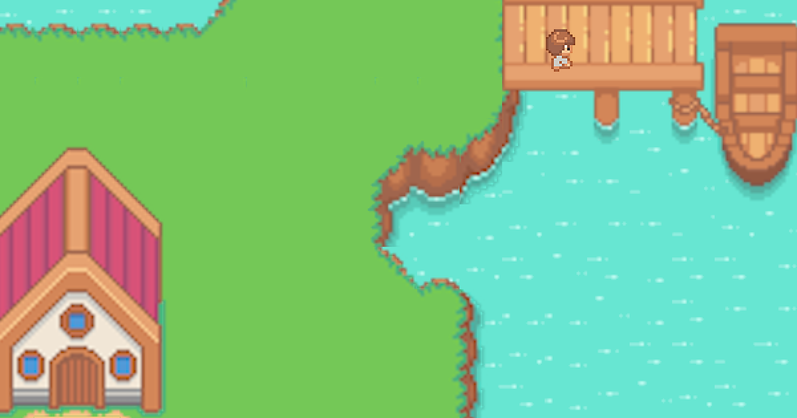

# Le monde de Pyve

Le portfolio de Pyve, à explorer comme un mini-RPG en pixel art : [pyve.is-a.dev](https://pyve.is-a.dev).



Le visiteur se promène sur deux îles reliées par un pont. Il entre dans la maison (la bio), lit le panneau de l'atelier (les projets), visite le lab dans l'annexe et rejoint le bateau au ponton (le contact). Une version texte reprend tout le contenu, pour qui préfère lire, et pour les lecteurs d'écran comme pour les moteurs de recherche.

## Démarrer

Il faut Node 24 (voir `.nvmrc` ; Node 22.12 au minimum).

```bash
npm ci
npm run dev        # http://localhost:5173
```

| Commande            | Rôle                                                                     |
| ------------------- | ------------------------------------------------------------------------ |
| `npm run dev`       | Serveur de développement Vite                                            |
| `npm run build`     | Vérification des types, puis build de production dans `dist/`            |
| `npm run preview`   | Sert `dist/` en local                                                    |
| `npm run lint`      | ESLint (flat config, `eslint.config.js`)                                 |
| `npm run format`    | Formate le code avec Prettier ; `npm run format:check` vérifie seulement |
| `npm run typecheck` | TypeScript 5 en mode `strict` (`tsc -b`)                                 |
| `npm test`          | Vitest et Testing Library ; `npm run test:watch` en continu              |

Ajoutez `?debug` à l'URL (par exemple `http://localhost:5173/?debug`) pour voir les tuiles solides, les zones d'interaction, les points d'apparition et la hitbox du héros, avec ses coordonnées. Un clic sur la carte y téléporte le héros.

## Architecture

```
src/
  app/        historique, routes, page 404, page d'erreur, adresses (anciens liens /#/…, /home.html)
  content/    tout le texte visible : contrat (types.ts), contenu, microcopie (ui.ts)
  engine/     logique pure, sans React : parsing Tiled, collisions, caméra, entrées
  game/       écran de jeu : boucle, contrôleur du héros, rendu de la carte
  ui/         dialogue, HUD, journal de quête, aide, croix tactile, version texte
  quest/      progression de la quête (localStorage)
  lib/        petits hooks et accès au stockage
  maps/       cartes Tiled (.json) et leurs fonds (.webp)
tools/map-art/ fabrique les fonds des cartes : dessin à 16 px, sprites, script
vite-plugins/ tiled-map.ts (cartes allégées) et site-pages.ts (métadonnées, pages statiques)
```

- **Boucle de jeu.** `useAnimationFrame` appelle le contrôleur du héros à chaque frame avec un delta-time, plafonné à 50 ms pour ne jamais traverser un mur après un onglet en pause. La vitesse est de 120 px/s. Le héros et la caméra bougent par `transform`, écrits directement dans le DOM via des refs : React ne se re-rend que lorsque l'objet à proximité change.
- **Collisions.** La grille vient du calque `collisions` de Tiled. Le déplacement est résolu axe par axe (X puis Y) contre les tuiles solides, ce qui fait glisser le héros le long des murs. Sa hitbox couvre ses pieds (14 × 8 px), comme dans les RPG vus de dessus.
- **Caméra.** Elle centre le héros sans jamais montrer l'extérieur de la carte, et centre une carte plus petite que l'écran. L'échelle donne un nombre entier de pixels physiques par pixel de la carte (`image-rendering: pixelated`), avec environ douze tuiles sur le petit côté de l'écran.
- **Pas de Redux.** L'état qui change à chaque frame vit dans des refs. Ce qui est ouvert (un lieu, l'aide, la version texte) se lit dans l'adresse et l'entrée d'historique, si bien que Retour le referme ; seuls l'accueil de la maison et l'aide de première visite, qui s'ouvrent d'eux-mêmes, sont un état local. La quête est un petit store branché sur `useSyncExternalStore`. Un store global n'apportait rien.
- **Routage en mode history**, sans bibliothèque : `src/app/history.ts` tient l'historique (`pushState`, `replaceState`, `popstate`) et `src/app/router.tsx` choisit l'écran. Pour trois routes statiques, React Router pesait 90 ko sur 390 (25 ko compressés). `/` et `/work` partagent le même écran : `/work` ouvre les projets, et fermer le dialogue ramène à `/`. `/home` est l'intérieur de la maison. Toute autre URL affiche la page 404 du jeu, et une frontière d'erreur (`RouteError`) remplace un écran blanc par la page d'erreur du jeu. Avant le premier rendu, `src/app/location.ts` réécrit les adresses que GitHub Pages sert aussi (`/home.html`, `/work/`, `/index.html`) et les anciens liens `/#/home` et `/#/work`. Le mode history donne des URL réelles, distinctes pour les moteurs de recherche et les aperçus de liens, au prix des pages statiques décrites plus bas.
- **Build.** `vite-plugins/tiled-map.ts` sert les imports `*.json?tiled` sans les tilesets ni les tuiles visuelles, déjà dessinées dans le `.webp` (world.json passe de ~850 kB à ~90 kB). `vite-plugins/site-pages.ts` écrit dans `index.html`, à partir de `src/content`, le titre, la description, l'URL canonique, les balises Open Graph, le préchargement de la carte et la version texte du portfolio (`vite-plugins/static-page.ts`). Celle-ci est remplacée par le jeu quand il démarre ; elle s'affiche sans JavaScript, ou quand le jeu ne peut pas démarrer (script bloqué ou en erreur). Il produit aussi `home.html`, `work.html` et `404.html`, ainsi que `sitemap.xml` et `robots.txt`, écrits pour le domaine de `public/CNAME`. `public/.nojekyll` évite à GitHub Pages de passer le site dans Jekyll.

### GitHub Pages

| URL demandée | Fichier servi               | Statut |
| ------------ | --------------------------- | ------ |
| `/`          | `index.html`                | 200    |
| `/home`      | `home.html`                 | 200    |
| `/home/`     | `home/index.html`           | 200    |
| `/work`      | `work.html`                 | 200    |
| `/work/`     | `work/index.html`           | 200    |
| autre        | `404.html` (copie de l'app) | 404    |

Les pages ont chacune leur titre, leur description, leur URL canonique (sans barre finale) et leurs balises Open Graph ; `home/index.html` et `work/index.html` sont des copies de `home.html` et `work.html`, car GitHub Pages répond 404 à `/home/` sans elles. La page 404 sert aussi de repli SPA : l'app y affiche la bonne route (par exemple `/HOME`, Pages respectant la casse) ou la page « introuvable ».

## Éditer le contenu

Tout texte visible passe par `src/content/index.ts`, l'unique point d'entrée. Les composants ne contiennent aucun texte en dur.

- `types.ts` définit le contrat : `SiteContent`, `Place`, `ContentBlock`, etc.
- Le contenu du portfolio vit dans `site.ts`, que `index.ts` exporte. `site.placeholder.ts` en garde une version neutre de même forme, pratique pour travailler sur le moteur : une ligne d'`index.ts` suffit pour basculer.
- `ui.ts` contient la microcopie du moteur : aides du HUD, boutons, noms accessibles, titres de page.
- Typographie : apostrophe droite, et espace insécable (U+00A0) avant `? ! : ;`. ESLint accepte ces espaces dans les chaînes.

Les textes sont des blocs (`paragraph`, `list`, `projects`) rendus en HTML sémantique, jamais injectés comme du HTML brut. La même source alimente les dialogues, l'écran d'aide, les métadonnées et la version texte, dans l'app comme dans le HTML de chaque page.

## Éditer une carte dans Tiled

Les cartes `src/maps/world.json` et `home.json` sont des exports JSON de [Tiled](https://www.mapeditor.org/) (tuiles de 32 px). Tiled sert à peindre les collisions et à placer les objets ; les images des cartes se fabriquent avec `tools/map-art` (voir plus bas). Les tilesets d'origine (`First Asset pack`, `Serene_Village`, `InteriorObjects`, `meta_tiles`…) ne sont pas dans ce dépôt : leurs calques restent dans les cartes, comme plan.

Le moteur lit seulement le groupe de calques `meta` :

- un calque de tuiles `collisions` (propriété `action` = `collision`) : toute tuile non vide est solide, hors de la carte aussi ;
- le calque d'objets `objects`. Chaque objet a une propriété `action` (ou une classe Tiled) :

| `action`   | Nom de l'objet         | Propriétés                              | Effet                                                                                                              |
| ---------- | ---------------------- | --------------------------------------- | ------------------------------------------------------------------------------------------------------------------ |
| `place`    | un `PlaceId`           | `radius` (facultatif, 24 px par défaut) | Ouvre le dialogue du lieu. Plusieurs objets peuvent ouvrir le même lieu.                                           |
| `redirect` | libre, ou un `PlaceId` | `value` (route, ex. `/home`), `radius`  | Mène à une autre route. Nommé par un lieu, il en prend l'étiquette et la zone ; sinon « Sortir ».                  |
| `spawn`    | libre                  | `value` (route d'arrivée), `direction`  | Point d'apparition : sans `value`, celui par défaut ; sinon pour une arrivée depuis cette route ou ce lien direct. |
| `decor`    | libre                  | `value` (nom du décor, ex. `leds`)      | Petit décor animé dessiné par le moteur : diodes (`leds`), voyant de l'antenne (`beacon`) et néon (`neon`) du lab. |

### Les images des cartes

Les tuiles font 32 px, mais le pixel art est dessiné à 16 px la tuile : un pixel du dessin couvre 2 × 2 pixels de la carte. `npm run map-art` (`tools/map-art/build.ts`, sans dépendance, mais il faut `cwebp`, de libwebp) fabrique les images du jeu à partir de :

- `tools/map-art/world.png` et `home.png` : le fond de chaque carte, à un pixel par pixel du dessin, à retoucher dans un éditeur de pixel art ;
- `tools/map-art/sea.png` : quatre tuiles sur quatre de mer, que le moteur répète autour de la grande carte ;
- les sprites de `tools/map-art/sprites/`, écrits en texte : un caractère par pixel, une palette par sprite ;
- le calque d'objets `art` de chaque carte, hors du groupe `meta` : chaque rectangle porte le nom d'un sprite et sa taille, en coordonnées paires (la grille du dessin), et ils sont dessinés dans l'ordre du calque. La propriété booléenne `solid` marque ce que le héros contourne, panneaux et meubles : les tests vérifient que les tuiles dessous sont solides.

Le script écrit `src/maps/world.webp`, `home.webp` et `src/img/sea.webp`, deux fois plus grands, en WebP sans perte (`cwebp -lossless -z 9 -exact`). `npm run map-art -- --check` vérifie qu'ils sont à jour (il faut aussi `dwebp`).

Ces fonds viennent des exports de Tiled d'origine, dont les tuiles de 16 px avaient été agrandies en lissant : bords flous, liserés autour des maisons, coutures entre les tuiles. Ils ont été redessinés une fois sur la grille de 16 px, avec une palette réduite et des chemins nettoyés ; un nouvel export de Tiled n'est donc plus la source des images.

La grande carte est recadrée sur ce que la caméra peut montrer : l'export de Tiled mesurait 3841 × 3870 px, presque tout en mer, soit environ 60 Mo décodés. Les propriétés de la carte `crop-x`, `crop-y`, `crop-width` et `crop-height` (_Carte → Propriétés de la carte_) donnent ce cadre en pixels de l'export, qui s'agrandit pour inclure les décalages des calques ; le moteur en déduit où poser l'image.

Autour du fond recadré, le moteur prolonge la mer avec `src/img/sea.webp`, posée sur la grille de la carte. Les tests de `src/game/maps.test.ts` vérifient que l'image a la taille du cadre, que toute tuile hors du calque `Sea` tient dedans, et que la caméra ne montre que l'image sur les écrans courants (téléphones dans les deux sens, tablettes, écrans jusqu'au 21:9). Si les îles s'agrandissent, élargissez le cadre et `world.png`.

Après une modification, lancez `npm test` : les tests de `src/game/maps.test.ts` vérifient que chaque lieu, porte et point d'apparition reste accessible à pied depuis le point de départ, et ceux de `tools/map-art` que chaque sprite tombe sur la grille du dessin. Contrôlez ensuite avec `?debug`.

## Ajouter un lieu

1. Ajoutez l'identifiant à `PlaceId` dans `src/content/types.ts` et à `PLACE_ORDER` dans `src/content/places.ts` (le compilateur signale ce qui manque).
2. Écrivez son contenu dans `site.ts` et dans `site.placeholder.ts` : étiquette (12 caractères au plus), zone, titre, blocs, liens, objectif de quête.
3. Dans Tiled, ajoutez au calque `meta/objects` un rectangle nommé par l'identifiant, avec `action` = `place`. Pour un nouveau bâtiment, dessinez-le dans `tools/map-art` et ajoutez les tuiles solides et, si besoin, un `decor`.
4. Pour lui donner sa propre URL, comme `/work`, déclarez-la dans `PATHS` et `STATIC_PAGES` (`src/app/pages.ts`) et dans `placeRoutes` (`src/game/maps.ts`), puis ajoutez son écran dans `src/app/router.tsx`.
5. Lancez `npm test` : le journal de quête et la version texte prennent le lieu en compte d'eux-mêmes.

## Accessibilité

- Clavier : flèches, ZQSD ou WASD pour marcher, Espace ou Entrée pour agir, `?` pour l'aide. Le premier Tab tombe sur « Aller à la version texte ».
- Les dialogues reposent sur `<dialog>` en mode modal : `aria-labelledby` pointe vers le titre et le focus reste dans le dialogue. Il part sur le contenu, une région que les flèches font défiler ; Espace ou Entrée gardés enfoncés depuis le jeu n'y pressent rien. Échap, le bouton Fermer, le fond (un appui qui y commence et y finit) et Retour le ferment, puis le focus revient où il était, ou sur « Version texte ».
- Le HUD visible n'est pas une région live : une ligne `role="status"`, masquée, annonce l'arrivée près d'un lieu (« Panneau des projets. Espace ou Entrée : Projets ») et les messages, sans rien dire quand le héros s'éloigne.
- Le contour de focus est double, jaune dans un bord sombre : l'un des deux contraste à 3:1 au moins avec ce qui est derrière, la mer comme les panneaux. Liens et boutons font au moins 44 px de haut.
- Sur écran tactile, A agit dès que le doigt se pose, même pendant qu'un autre tient la croix ; son nom accessible, « A : interagir », reprend la lettre affichée.
- La version texte reste dans le DOM même fermée ; ses liens sortent alors de l'ordre de tabulation.
- `prefers-reduced-motion` coupe les animations décoratives. La croix tactile n'apparaît que sur écran tactile (`pointer: coarse`). La page ne défile pas et le double-tap ne zoome pas ; le pincement reste possible.

## Déploiement

Le site est servi par GitHub Pages depuis la branche `main` du dépôt [`pvignau/pvignau.github.io`](https://github.com/pvignau/pvignau.github.io), sur le domaine `pyve.is-a.dev` (fichier `CNAME`). Le déploiement est manuel.

- [ ] Partir de `main` à jour dans ce dépôt, puis `npm ci`.
- [ ] `npm run lint && npm run typecheck && npm test && npm run build`, sans erreur.
- [ ] Vérifier le build comme sur GitHub Pages : `npx serve dist`, puis ouvrir `/`, `/home`, `/home/`, `/work`, `/une-page-inconnue` (page « introuvable » avec un statut 404) et `/#/home` (redirigé vers `/home`), et une page sans JavaScript (la version texte remplace le chargeur).
- [ ] Dans le clone de `pvignau.github.io`, mettre `main` à jour (`git pull`).
- [ ] Remplacer l'ancien build par `dist/` en gardant `CNAME` et l'historique git :
      `rsync -av --delete --exclude .git --exclude CNAME dist/ ../pvignau.github.io/`
      (`dist/` contient aussi `CNAME`, copié depuis `public/`).
- [ ] `git status` dans `pvignau.github.io` : `CNAME` inchangé ; présence d'`index.html`, `home.html`, `work.html`, `404.html`, `sitemap.xml`, `robots.txt`, `.nojekyll`, `manifest.json`, des icônes, d'`og-image.png` et d'`assets/` ; plus de `css/` ni d'`img/` de l'ancien build.
- [ ] Commit (par exemple `deploy: website@<sha court>`), puis `git push origin main`.
- [ ] Une fois Pages déployé (quelques minutes, voir l'onglet _Actions_), vérifier `https://pyve.is-a.dev/`, `/home`, `/work`, une URL inconnue et un ancien lien `/#/work`, puis l'aperçu d'un lien partagé (par exemple sur opengraph.xyz).

### Proposition : déploiement automatique (non activé)

Cette GitHub Action, à placer dans `.github/workflows/deploy.yml` de ce dépôt, publierait `dist/` dans `pvignau.github.io` à chaque push sur `main`. Elle demande une clé de déploiement avec droit d'écriture sur `pvignau.github.io`, dont la partie privée est stockée dans le secret `PAGES_DEPLOY_KEY` de ce dépôt.

```yaml
name: Deploy

on:
  push:
    branches: [main]
  workflow_dispatch:

permissions:
  contents: read

concurrency:
  group: deploy
  cancel-in-progress: true

jobs:
  deploy:
    runs-on: ubuntu-latest
    steps:
      - uses: actions/checkout@v4
      - uses: actions/setup-node@v4
        with:
          node-version-file: .nvmrc
          cache: npm
      - run: npm ci
      - run: npm run lint
      - run: npm run typecheck
      - run: npm test
      - run: npm run build
      - uses: peaceiris/actions-gh-pages@v4
        with:
          deploy_key: ${{ secrets.PAGES_DEPLOY_KEY }}
          external_repository: pvignau/pvignau.github.io
          publish_branch: main
          publish_dir: ./dist
          cname: pyve.is-a.dev
          commit_message: 'deploy: ${{ github.repository }}@${{ github.sha }}'
```

## Licences et crédits

- Police [Pixelify Sans](https://github.com/eifetx/Pixelify-Sans), sous SIL Open Font License 1.1 (`src/fonts/pixelify-sans/OFL.txt`), auto-hébergée. Elle remplace la police Minecraft d'origine, qui ne contenait aucune lettre accentuée.
- Les fonds des cartes et le héros viennent des packs cités dans les fichiers Tiled, qui gardent leurs licences d'origine. Les icônes et l'image `og-image.png` en sont dérivées.
- Les sprites de `tools/map-art/sprites/` (panneaux, lab, mobilier de la maison) sont dessinés pour ce site.
